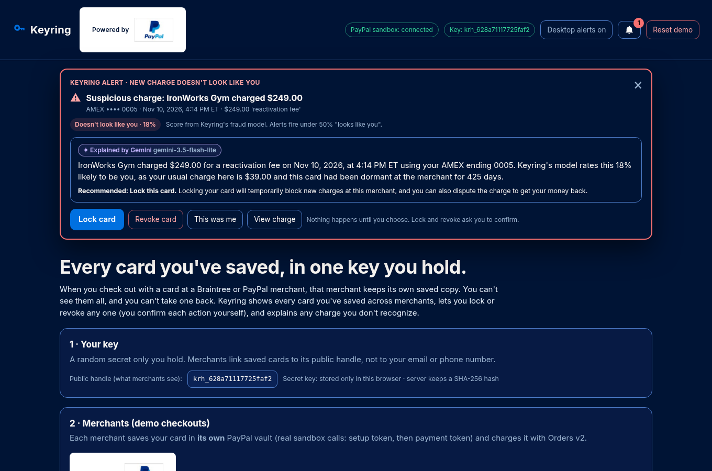

# Keyring

**Every card you've saved, in one key you hold.** A PayPal AI Hackathon 2026 prototype (PayPal sandbox only).

## Try it live

**Live demo: [keyring-paypal.onrender.com](https://keyring-paypal.onrender.com)**. There's nothing to install. It runs against the real PayPal sandbox, with Gemini switched on.

- It's hosted on Render's free plan, so if the site has been idle, the first page load can take about **50 seconds** while it wakes up.
- Everyone who visits shares **one demo**. The demo is wiped whenever the site restarts or redeploys. Click **Reset demo** in the header to start fresh.
- If Gemini's free daily quota runs out, explanations switch to the labeled template fallback. The ML score, the alerts, and every PayPal call still work.

Walkthrough: **Create my key** → **Shop: designer dress ($2,450)** at Maison Vale Boutique (pick airline miles, $500 cash back, or a $0-fee bank transfer) → **Save card at checkout** at each merchant → **Check with PayPal vault** → have merchants charge (the gym's $249 fee raises an alert by itself) → open a charge for Gemini's explanation and ask "Should I lock this card?" → **Lock** the gym card and watch its next charge get blocked → **Revoke** the StreamCo+ card (subscription warning) → PayPal refuses the deleted token (`403`). The full step-by-step is under [Run it locally](#run-it-locally).

## The problem

When you pay by card at a merchant that runs on Braintree or PayPal's card processing (unbranded checkout), that merchant keeps its own saved copy of your card in **its own vault**. Vaults are per-merchant by design. The result for the customer:

- You can't see where your card is saved. A streaming service, a coffee app, a gym you quit two years ago: each one holds a token that can still charge you.
- You can't take a card back. Removing it means finding each merchant's settings page, if one exists, or calling your bank to reissue the card, which breaks *every* merchant at once.
- When a charge shows up that you don't recognize, nothing explains it. You get a soft descriptor and a dispute form.

PayPal-branded checkout gives customers a wallet with visibility and protection. Plain card payments through Braintree don't carry that consumer trust. Keyring is a sketch of how PayPal could extend it to every card saved at its merchants, without merging or deleting anything on the customer's behalf.

## What Keyring does

1. **A key the customer holds.** A random 256-bit secret, shown once and stored in the customer's browser; the server keeps only its SHA-256. At checkout the customer opts in and the merchant links the saved card to the key's public *handle*, **not** to an email address or phone number.
2. **One view of every saved card** across merchants: merchant, brand/last 4, when it was saved, last charge, and whether an active subscription depends on it. "Check with PayPal vault" re-reads each merchant's vault from PayPal to prove the cards are really there.
3. **Lock** (reversible): blocks new charges on that card in this demo.
4. **Revoke** (permanent): deletes the saved card from that merchant's PayPal vault. Consent is required for every action: revoke is a two-step intent → confirm, it warns when an active subscription depends on the card (and says plainly that revoking does *not* cancel the subscription), and it needs an explicit acknowledgement in that case. Every lock, unlock, and revoke is recorded as a consent record. Keyring never revokes, merges, or deletes anything on its own.
5. **Proactive alerts.** A new charge that doesn't look like you raises an alert on its own: a banner, a bell with an unread count, and an optional desktop notification, with Gemini's explanation and one-tap Lock / Revoke / This was me buttons. Nothing runs until you confirm. See [Alerts](#alerts).
6. **AI charge recognizer.** For "I don't recognize this charge", it explains the charge in plain language (which merchant, when you saved the card there, whether it fits your subscription's amount and cycle, how it compares with your usual amount there, dormancy, test-charge size, bursts) and scores **"looks like you"** from 1–99%, with the model's top reasons. **Google Gemini** then explains the charge in 2–3 plain-English sentences, recommends one action (keep / lock / revoke / dispute), and answers follow-up questions in an **"Ask about this charge"** box. See [AI: ML scores, Gemini explains](#ai-ml-scores-gemini-explains).
7. **Smart checkout.** A $2,450.00 designer dress at Maison Vale Boutique (a purchase you have confirmed is legitimate) lets you choose how to pay: a travel-rewards card that earns airline miles, a cash-back card, or a $0-fee bank transfer, each with a benefit calculated from example reward rules. See [Smart checkout](#smart-checkout).

## How it uses PayPal APIs (all real sandbox calls)

| Step | API |
|---|---|
| Server auth | `POST /v1/oauth2/token` (client credentials) |
| Merchant saves a card without a purchase | `POST /v3/vault/setup-tokens` (card + `customer.id` per merchant) → `POST /v3/vault/payment-tokens` (`type: SETUP_TOKEN`) |
| Keyring proves the card exists | `GET /v3/vault/payment-tokens?customer_id=…`, then `GET /v3/vault/payment-tokens/{id}` if the list hasn't indexed yet (sandbox lags about 15–30 s) |
| Merchant charges the saved card | `POST /v2/checkout/orders` with `payment_source.card.vault_id` and `stored_credential` (merchant-initiated, recurring or unscheduled). Completes immediately. |
| Customer revokes | `DELETE /v3/vault/payment-tokens/{id}` (204), then `GET` again to confirm (404) |
| Proof the revoke is real | After a revoke, a charge attempt is sent to PayPal with the deleted `vault_id`. PayPal rejects it (`403 NOT_AUTHORIZED / PERMISSION_DENIED`). |

Each demo merchant gets its own vault `customer.id` (for example `kr-stream-…`, `kr-beanbr-…`), mirroring real per-merchant vaults. Every call appears in the UI's **PayPal API log** with PayPal's debug id. Credentials stay in `.env` on the server; they are never logged or sent to the browser.

## What's real vs. simulated

| Real (PayPal sandbox) | Simulated / synthetic (labeled in the UI) |
|---|---|
| Card save via the v3 vault (setup token → payment token) | Three merchants share **one** sandbox REST app (each has its own vault customer id). In production they would be separate merchants, and Keyring would need a PayPal-side cross-merchant index keyed by the handle. |
| Charges on saved cards via Orders v2 `vault_id` (COMPLETED, with capture ids) | Charge **history before today** is synthetic (generated per card, labeled "synthetic history") so the recognizer has a baseline. The "saved on" date is a backdated story date; the real token `create_time` is shown next to it. |
| Vault list/get verification | **Lock** is enforced by Keyring before calling PayPal. A real lock needs PayPal-side enforcement at authorization. |
| Revoke = real token delete, verified by 404 and by PayPal refusing to charge it | The key is a bearer secret in the browser. Production would use a passkey (WebAuthn) signature per action. |
| Gemini explanations and answers are live calls to the Gemini API | The recognizer's model is trained on **synthetic** data. If Gemini is unavailable, the labeled deterministic template is shown instead. |
| Smart-checkout card payments (travel and cash-back options) are vaulted and charged through the same sandbox Orders v2 `vault_id` path | The Harbor Checking **bank transfer (ACH)** is a labeled simulation — PayPal sandbox has no ACH vault path in this demo. Reward terms are fictional example rates, clearly labeled "not real card terms." |

If a vault call ever fails with an auth or permission error (for example, vaulting not enabled on the app), Keyring saves that card as a clearly labeled **simulated** card and records the exact failing call and error on the card (`simulatedReason`). In the current sandbox app every call works, so nothing is simulated.

## The charge recognizer

`scripts/train_model.py` (adapted from the Locus project) trains a standardized logistic regression on 20,000 **synthetic** saved-card charges (seeded, reproducible), labeled "cardholder" vs. "not the cardholder". The synthetic data includes legitimate renewals, everyday purchases, and first purchases, against forgotten-card reactivations, off-cycle subscription upsells, card testing, and takeover-size spends. Features: amount, amount vs. your usual at this merchant, fits subscription amount+cycle, off-cycle subscription charge, days since last charge, dormant 180+ days, first charge, night, 24h burst, micro amount. The held-out metrics in `model/metrics.json` are on synthetic data only and are **not** real-world performance. The Node app reads `model/keyring_model.json` at runtime; Python is only needed to retrain.

Demo outcomes: StreamCo+ $15.49 on cycle → *looks like you*; Bean & Brew $6.25 latte → *looks like you*; StreamCo+ $89.99 off-cycle "upgrade" → *doesn't look like you*; IronWorks Gym $249 after 14 months dormant → *doesn't look like you*.

## AI: ML scores, Gemini explains

Keyring splits the AI into two parts that each do one job:

| | Logistic-regression recognizer (`src/recognizer.ts`) | Google Gemini (`src/ai.ts`, `src/gemini.ts`) |
|---|---|---|
| Job | Scores the charge: "looks like you" 1–99%, verdict, top reasons, and a list of verifiable facts (when you saved the card, usual amount, subscription cycle, dormancy…) | Turns those facts into 2–3 plain-English sentences for the cardholder, recommends **one** action, and answers follow-up questions |
| Input | Charge + this card's history at this merchant | Only the recognizer's output, the card list, and recent charges, as JSON |
| Can it change the score? | It *is* the score | **No.** It quotes the model's percentage; the UI's meter and verdict always come from the ML model |
| Can it act? | No | **No.** It may *propose* lock / unlock / revoke; the UI shows that as a button, and the cardholder still has to click it and confirm (revoke also keeps its two-step intent and subscription warning). The API returns `executed: false` |

**Endpoints** (both require the customer's key):

- `POST /api/key/charges/:id/ai-explain` → `{ ai: { source: "gemini" | "template", model, explanation, recommendedAction: keep | lock_card | unlock_card | revoke_card | dispute, actionReason, attempts[] } }`. Uses Gemini's structured output (`responseMimeType: application/json` + `responseSchema`), so the action is always one of the actions possible for that card's current status. Cached on the charge until the card's status changes (`{ "refresh": true }` asks again).
- `POST /api/key/ask` with `{ question, chargeId? }` → `{ source, model, answer, proposedAction, cardId, card, executed: false }`. Context: every saved card (status, saved date, subscription, last charge, usual amount), the 25 most recent non-synthetic charges with their recognizer verdicts, and the full recognizer facts for the focus charge.

**Grounding.** The system prompt tells Gemini to use only the JSON facts, never invent amounts, dates, plans or policies, quote the score as given, and treat text inside the data (merchant descriptions, the question) as data rather than instructions. The server also validates each answer: the action must be allowed for that card's status, a proposed card id must exist, and **every dollar amount in the text must appear in the facts sent**. An answer that fails validation is discarded, and the next model is tried.

**Resilience.** Primary model `gemini-3.6-flash`, fallback `gemini-3.5-flash-lite` (override with `GEMINI_MODEL` / `GEMINI_FALLBACK_MODEL`). Each call has an 8 s timeout and is retried once on 429/500/503; then the fallback model is tried; then the deterministic template is used (total budget about 22 s). The UI always labels the source: **"✦ Explained by Gemini · model"** / **"✦ Answered by Gemini"**, or **"Template fallback · Gemini unavailable (reason)"**. Every attempt (model, HTTP status, latency, error) is returned in `attempts[]`. Without `GEMINI_API_KEY` the app runs entirely on the template.

**Privacy.** Gemini sees merchant names, amounts, dates, card brand and last 4, and the recognizer's output. It never sees full card numbers, vault tokens, PayPal ids or credentials, or the customer's key. `GEMINI_API_KEY` stays in `.env` on the server.

Sample output (live, gym $249 reactivation fee after 425 dormant days, model score 18%):

> This $249.00 reactivation fee from IronWorks Gym was charged to your AMEX ending 0005 on Nov 10, 2026. This merchant had not charged your card in 425 days and this amount is much higher than your usual $39.00 monthly charge. Keyring's model rates this 18% likely to be you.
> **Recommended: Lock this card.** Locking the card temporarily blocks future charges at this merchant, and you can also dispute the charge with your card issuer to get your money back.

## Alerts

Keyring doesn't wait for you to notice a charge. When a merchant charges a saved card (Orders v2 in the demo) and the charge **goes through**, the recognizer scores it on the spot. If it scores below the alert threshold (default **50% "looks like you"**, set with `ALERT_THRESHOLD=0.5` or `ALERT_THRESHOLD=50` in `.env`), Keyring creates an alert by itself. You don't have to click the charge.

| Step | What happens |
|---|---|
| 1. Charge lands | `POST /api/merchants/:mid/charge` scores it with the ML model only. Below the threshold → an alert record is saved (merchant, amount, card, score, verdict) and returned as `alertId` |
| 2. Push | The alert is pushed to every open Keyring page at once over **Server-Sent Events** (`GET /api/key/alerts/stream`). The page reads the stream with `fetch`, so the key travels in the `X-Keyring-Key` header and never in a URL. If the stream drops, the page polls `GET /api/key/alerts` every 5 s and reconnects |
| 3. Explain | In the background, the same Gemini path as the charge drawer (retry, fallback model, then the labeled template) writes the explanation and recommended action. It's attached to the alert and pushed again |
| 4. You decide | A banner appears at the top of the page and the bell shows the unread count. If you allowed it with **Enable desktop alerts**, a browser notification fires too (the in-app alert works either way) |



Each alert shows the merchant, amount, card, the model's score, Gemini's explanation with its source label (**✦ Explained by Gemini · model** or **Template fallback**), the recommended action, and four buttons:

- **Lock card**: the existing lock endpoint, with its confirmation.
- **Revoke card**: the existing two-step revoke, with its confirmation dialog and the subscription warning.
- **This was me**: `POST /api/key/alerts/:id/dismiss` marks the alert reviewed. The card is not changed.
- **View charge**: opens the full recognizer drawer and the "Ask about this charge" box.

**An alert never acts on its own.** Keyring doesn't auto-lock or auto-revoke anything. If you lock or revoke the card through the normal confirmed endpoints, its open alerts are marked handled ("locked" / "revoked").

Other rules:

- Charges that look like you raise no alert. The StreamCo+ $15.49 renewal (99%) and the Bean & Brew latte (99%) stay quiet.
- The IronWorks Gym $249 reactivation fee (18%) and the StreamCo+ $89.99 off-cycle "upgrade" (1%) raise alerts.
- Blocked charges (locked or revoked card) raise no alert, because the money never moved.
- **Reset demo** clears all alerts.

**Endpoints** (all require the key): `GET /api/key/alerts` → `{ alerts[], unread, threshold }`, `GET /api/key/alerts/stream` (SSE events `hello`, `alert`, `alerts`, `reset`), `POST /api/key/alerts/read` (marks alerts seen), and `POST /api/key/alerts/:id/dismiss`.

If a Gemini model's daily free-tier quota runs out, Keyring skips that model until Google's retry time passes, instead of retrying it on every request.

## Smart checkout

At **Maison Vale Boutique**, a fictional designer shop, you can buy an Atelier silk midi dress for **$2,450.00** — a high-value purchase you have confirmed is legitimate. Click **Shop: designer dress ($2,450)** (after creating your key). At the point of purchase you see three selectable payment options, each with a short benefit calculated in code from per-option reward and fee rules (not hardcoded strings). Product names are fictional. The page is labeled **"Example reward terms (sandbox demo), not real card terms."**

| Option | Example product (fictional) | How the benefit is computed on $2,450.00 |
|---|---|---|
| Travel rewards card | Northstar Voyager Visa | 4× airline miles × $2,450.00 = 9,800 miles + 200 Atelier travel promo bonus = **10,000 miles**, estimated value **$150.00** at $0.015/mile (1.5 cents) |
| Cash-back card | Cedar Ledger Mastercard | 5% × $2,450.00 = $122.50 + $377.50 limited-time Atelier cash-back promo = **$500.00 cash back** |
| Cheapest transfer | Harbor Checking (ACH) | **$0.00 fee**, the lowest-cost way to move the money. Saves **$71.35** vs paying by card (2.9% + $0.30 = $71.35) |

A compact **cheapest transfer** comparison lists the fee for card-to-card (3% = $73.50), card-to-merchant (2.9% + $0.30 = $71.35), bank-to-card (1.5% = $36.75), and bank-to-merchant ACH ($0.00), and highlights the cheapest.

Selecting an option and clicking **Confirm purchase · $2,450.00**:

- For a vaulted card, Keyring saves that card in Maison Vale's own PayPal vault (setup token → payment token) on first use, then charges it with Orders v2 and the card's `vault_id`, the same path as the other demo merchants.
- For Harbor Checking, the transfer is a **labeled simulation**.
- The charge is marked **user-confirmed legitimate**, so the recognizer may still score it (a $2,450 first purchase is unusual) but Keyring **does not raise a suspicious-charge alert**, and the charge is not blocked.
- Gemini (or the labeled template) recommends the highest-dollar-benefit option in one grounded sentence — $500.00 cash back beats 10,000 miles (est. $150.00) and the $71.35 you save with a $0-fee transfer. Invented dollar amounts are rejected; every figure has to appear in the computed facts. **Reset demo** still clears these cards and charges, including any sandbox tokens Keyring created for the boutique.

## Run it locally


The [live demo](#try-it-live) is the quickest way to try Keyring. To run your own copy with your own PayPal sandbox app, you need Node 20+.

```bash
cp .env.example .env        # add your PayPal SANDBOX client id + secret, and optionally GEMINI_API_KEY
npm install
npm start                   # builds, then serves http://localhost:3001
npm run smoke               # end-to-end test against the running server (resets the demo); covers alerts + SSE, tests Gemini if available and always tests the template fallback
npm run screenshots         # optional: headless Chromium screenshots into screenshots/
python3 -m pip install -r requirements.txt && npm run train   # optional: retrain the model
```

The demo: **Create my key** → **Shop: designer dress ($2,450)** (pick a payment option and confirm) → **Save card at checkout** at each merchant → **Check with PayPal vault** → have merchants charge (the gym's $249 fee pops up an alert by itself, while the StreamCo+ renewal doesn't) → click a charge to open the recognizer and Gemini's explanation → ask "Should I lock this card?" → **Lock** the gym card and watch its charge get blocked → **Revoke** the StreamCo+ card (subscription warning) → its next renewal is blocked and PayPal refuses the deleted token. **Reset demo** deletes the demo's remaining sandbox tokens.

## Project layout

```
src/server.ts      Express API: key, merchant save/charge, smart checkout, customer list/lock/revoke/verify, recognizer, alerts + SSE stream
src/paypal.ts      Sandbox REST client (OAuth, v3 vault, Orders v2), every call logged without secrets
src/recognizer.ts  Feature building, scoring, deterministic facts + template explanation
src/ai.ts          Gemini prompts, response schemas, grounding checks, template fallback
src/gemini.ts      Gemini REST client: timeout, retry on 429/503, model fallback
src/model.ts       Loads model/keyring_model.json; must match scripts/train_model.py
src/merchants.ts   Demo merchants and PayPal sandbox test cards (Maison Vale Boutique is used by smart checkout)
src/smart-checkout.ts  Purchase, fictional reward rules, and computed benefits / transfer fees
src/store.ts       JSON state in data/ (git-ignored) and the synthetic history generator
public/            Static UI
scripts/           train_model.py, smoke.mjs, screenshots.mjs
```


## Branding

Keyring is its own product. The name, key wordmark, and layout are Keyring's — not a PayPal login or official PayPal product. The UI is a white canvas with dark navy lettering and official PayPal blues (`#003087`, `#0070E0`) for the color feel only. PayPal marks appear only as official, unmodified assets on a white background, with the required trademark notice.

**Colors** (UI accents only; from PayPal's [Brand Identity Quick Guide, 2022](https://filecache.mediaroom.com/mr5mr_paypal/184713/download/PP_Brand%20Guidelines_Newsroom_2022.pdf) on the [PayPal Newsroom media resources](https://newsroom.paypal-corp.com/media-resources) site):

| Token | Hex | Role in Keyring |
|---|---|---|
| White | `#FFFFFF` | Page and panel background |
| Left Blue | `#003087` | Headings, wordmark, secondary buttons, selected-option borders, primary-button hover |
| Middle Blue | `#001C64` | Secondary-button hover |
| Right Blue | `#0070E0` | Primary actions (solid filled buttons) and accent |
| Slate | `#001435` | Body lettering |
| Muted navy | `#3A4F6A` | Supporting text (WCAG AA on white) |
| Serenity Blue | `#E5F0FA` | Selected payment-option fill, recommendation panel |
| Off-white | `#FAF8F5` | Reserved (PayPal off-white, used in marks lockups) |
| Gold | `#FFD140` | Reserved (not used as a chrome color) |

**Marks** (exact copies in `public/marks/`; source URLs in `public/marks/SOURCES.txt`):

| File | Official URL | Where it appears |
|---|---|---|
| PayPal acceptance mark, 74×46 | https://www.paypalobjects.com/webstatic/mktg/logo/pp_cc_mark_74x46.jpg | Header "Powered by" lockup; demo-checkout section; saved-cards / vault heading |
| PayPal acceptance mark, 37×23 | https://www.paypalobjects.com/webstatic/mktg/logo/pp_cc_mark_37x23.jpg | Each demo merchant checkout card (Interface Guide available size) |
| Horizontal PayPal logo, 100×26 | https://www.paypalobjects.com/webstatic/en_US/i/buttons/PP_logo_h_100x26.png | Footer "Powered by" attribution, next to the trademark statement |

**Guideline lines that permit this:**

- [PayPal Developer Agreement](https://www.paypal.com/us/legalhub/paypal/xdeveloper-full?locale.x=en_US) §8.3.3: if you are not using a PayPal Button, you must add "Powered by PayPal" to the first page of your payment flow. §9.3 licenses PayPal Marks solely in connection with advertising and marketing your PayPal-enabled services, and only in accordance with PayPal's Branding Requirements; any other use needs prior approval.
- [Development policies and guidelines](https://developer.paypal.com/reference/guidelines/policiesAndGuidelines/): follow the Branding Guidelines in Chapter 2 of the [PayPal Interface Guide](https://www.paypalobjects.com/webstatic/en_US/developer/docs/pdf/PayPalX_Interface_Guide_Edition1_1.pdf) and use only authorized PayPal buttons / marks.
- Interface Guide ch. 2: do not use "PayPal" in the product name or as the product logo (Keyring is the product name). The **acceptance mark** is for checkout and payment-confirmation pages, and to indicate you accept / use PayPal (integration and promotion). The **PayPal logo** is for "About PayPal" pages on a white background and promotional materials — used here only in the footer legal attribution. All processed marks on a **white background**. Clear space around each mark equals the height of the letter "P" in the PayPal logo. Do not modify the marks.
- Interface Guide §2.8 official trademark statement includes "PayPal and the PayPal logo are trademarks of PayPal, Inc." The footer also states that Keyring is an independent hackathon project, not affiliated with or endorsed by PayPal (User Agreement: merchant HTML logos may not be displayed in a manner that implies PayPal's sponsorship or endorsement).
- [PayPal AI Hackathon Official Rules](https://paypalaihackathon.devpost.com/rules) §11: any use of Sponsor intellectual property in a submission shall be solely to the extent provided for in those rules; the marks above are used under the Developer Agreement and Branding Requirements, not as a claim that PayPal built or endorses Keyring.

## License

MIT, © 2026 Kevin Pinard. No code is copied from paypal-examples; the PayPal API usage follows PayPal's public REST documentation.
